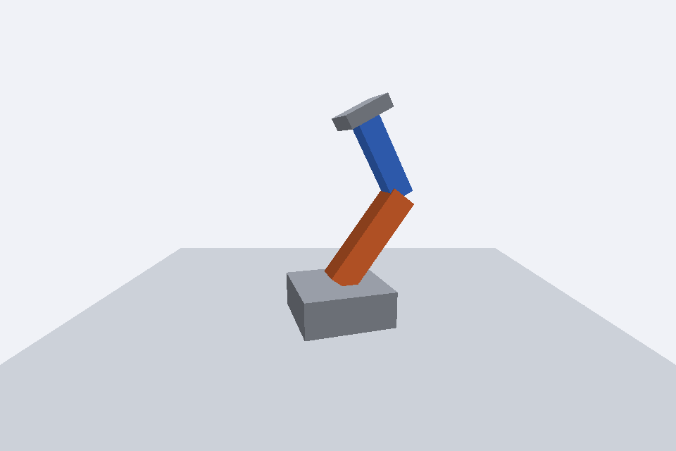

# Braço Robótico

**Disciplina:** Computação Gráfica  
**Atividade:** Braço Robótico  
**Integrante:** Leucimar Tiago da Silva Carvalho  
**Modalidade:** entrega individual, conforme informado pelo aluno.

## Descrição

A base cinza tem o ombro no topo. O braço laranja, de altura 1,2, fica deslocado 0,6 acima do ombro; o cotovelo fica a 1,2 do ombro. O antebraço azul, de altura 1,0, fica deslocado 0,5 acima do cotovelo. A garra cinza tem o centro a 1,0 do cotovelo. Os pivôs organizam a propagação das transformações.

A estrutura do professor foi preservada. Apenas os trechos indicados para preenchimento no arquivo `atividade_braco.py` foram alterados. Os módulos auxiliares, demonstrações, shaders e imagens são os originais da disciplina.

## Execução

Abra esta pasta `alunos` como projeto no PyCharm ou como diretório do terminal. Python 3.11 a 3.13; placa/driver com OpenGL 3.3 core.

### Windows (PowerShell)

```powershell
py -3 -m venv .venv
.venv\Scripts\python.exe -m pip install -r requirements.txt
.venv\Scripts\python.exe demo1_cena.py
.venv\Scripts\python.exe demo2_hierarquia.py
.venv\Scripts\python.exe demo3_camera.py
.venv\Scripts\python.exe atividade_braco.py
```

Feche cada demonstração com ESC para executar a próxima.

### macOS/Linux

```bash
python3 -m venv .venv
.venv/bin/python -m pip install -r requirements.txt
.venv/bin/python demo1_cena.py
.venv/bin/python demo2_hierarquia.py
.venv/bin/python demo3_camera.py
.venv/bin/python atividade_braco.py
```

## Controles e captura

A/D giram a base no eixo Y; W/S giram o ombro no eixo Z; I/K giram o cotovelo no eixo Z. Velocidade: 1,5 rad/s, multiplicada por deltaTime. ESC fecha.

Pressione **P** durante a execução para salvar `capturas/resultado.png`. A imagem abaixo foi produzida pela execução da solução. O braço está dobrado, conforme solicitado no enunciado.



## Resposta da questão

As caixas são centradas na origem local. Girá-las diretamente faria o braço e o antebraço girarem em torno dos próprios centros, deslocando as pontas e rompendo a conexão entre as peças. Os pivôs `Object3D` estabelecem a origem da rotação exatamente nas articulações: o ombro no topo da base e o cotovelo na extremidade superior do braço. Cada caixa é deslocada por metade da sua altura, deixando a ponta inferior no pivô. Pela hierarquia, a matriz mundial de um filho é a matriz mundial do pai multiplicada pela matriz local: girar a base leva todo o conjunto; girar o ombro leva cotovelo, antebraço e garra; girar o cotovelo leva antebraço e garra.

## Material de referência

- [Enunciado original](ATIVIDADE.md)
- [Orientações originais da aula](README_AULA_ORIGINAL.md)
- [Guia principal de avaliação — 6 pontos](../../GUIA_PRINCIPAL.txt)
