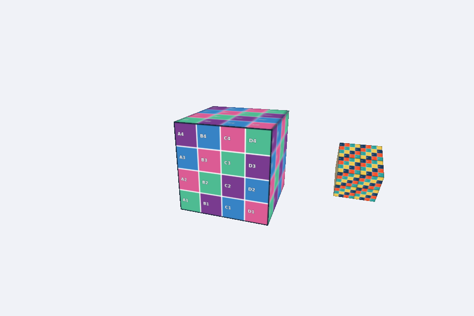

# Cubo com Satélite Texturizado

**Disciplina:** Computação Gráfica  
**Atividade:** Cubo com Satélite Texturizado  
**Integrante:** Leucimar Tiago da Silva Carvalho  
**Modalidade:** entrega individual, conforme informado pelo aluno.

## Descrição

O cubo principal usa mosaico.png. Seu filho satélite usa grade_uv.png com repeatUV = [2,2], posição local [1.3,0,0] e escala 0,4. A translação precede a escala, preservando a distância. O satélite acompanha a rotação do pai e gira localmente no eixo X a 2 rad/s.

A estrutura do professor foi preservada. Apenas os trechos indicados para preenchimento no arquivo `atividade_cubo.py` foram alterados. Os módulos auxiliares, demonstrações, shaders e imagens são os originais da disciplina.

## Execução

Abra esta pasta `alunos` como projeto no PyCharm ou como diretório do terminal. Python 3.11 a 3.13; placa/driver com OpenGL 3.3 core.

### Windows (PowerShell)

```powershell
py -3 -m venv .venv
.venv\Scripts\python.exe -m pip install -r requirements.txt
.venv\Scripts\python.exe exemplo_retangulo.py
.venv\Scripts\python.exe exemplo_cubo.py
.venv\Scripts\python.exe atividade_cubo.py
```

Feche cada demonstração com ESC para executar a próxima.

### macOS/Linux

```bash
python3 -m venv .venv
.venv/bin/python -m pip install -r requirements.txt
.venv/bin/python exemplo_retangulo.py
.venv/bin/python exemplo_cubo.py
.venv/bin/python atividade_cubo.py
```

## Controles e captura

↑ aumenta e ↓ diminui a velocidade de rotação do cubo principal em 1 rad/s por segundo; mínimo 0. O giro próprio do satélite continua a 2 rad/s. ESC fecha.

Pressione **S** durante a execução para salvar `capturas/resultado.png`. A imagem abaixo foi produzida pela execução da solução. 



## Resposta da questão

As coordenadas UV associam cada ponto da superfície a uma posição bidimensional da imagem: U corresponde à direção horizontal e V à vertical. O rasterizador interpola essas coordenadas nos triângulos para consultar a textura. Com `repeatUV = [2,2]`, o shader multiplica as coordenadas por 2 nas duas direções. Como a textura usa `GL_REPEAT`, cada face passa a exibir duas repetições horizontais e duas verticais da imagem, totalizando quatro cópias, sem mudar a geometria. O carregamento original inverte as linhas da imagem para compatibilizar sua origem superior com a origem inferior das coordenadas UV.

## Material de referência

- [Enunciado original](ATIVIDADE.md)
- [Orientações originais da aula](README_AULA_ORIGINAL.md)
- [Guia principal de avaliação — 6 pontos](../../GUIA_PRINCIPAL.txt)
